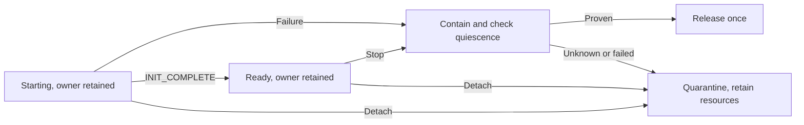

# First SGX545 firmware boot

The transport 0.9.0 [Atom capture](../research/sgx545/d2500hn-boot-inputs.json)
passed with 15 original native allocations, 36 pages, unchanged populated
contents, and zero live/error counters after teardown. The captured script has
2 pre-reset, 38 post-reset and 9 deinit writes.

The boot-input capture is complete. The current [stage/parent ownership
checkpoint](SGX545-STAGE-OWNER.md) tests real resource leases on host3 without
enabling GPU execution.

## Register and address audit

The [read-only audit](../research/sgx545/d2500hn-boot-register-audit.json) compares
both the original Intel 20120717 and pinned compatibility SGX545 headers.
Of 41 distinct script offsets, 22 have matching register names in both headers;
19 have no definitions in either. A register name is not a complete semantic
review of its values or timing. The unnamed writes remain an observed-only,
fixed recipe for the pinned initializer, with no invented register meanings.

The policy checks every executed operation, offset, value and order, the exact
boot controls and structure-size vector, original allocation tokens, logical
sizes, permissions, heap bounds and nonoverlap. Kernel code-base encoding,
event-kicker and boot-PDS pointers must agree with the original allocations.
The code-base encoding is the observed Intel encoding; this is not a newly
verified hardware specification. Diagnostic aliases do not satisfy the policy.

The original post-reset script writes `0x4000` to `EVENT_HOST_ENABLE` at `0x130`.
The candidate polling-only plan changes that value to zero, keeps both local
interrupt banks masked, and leaves the parent's SGX IRQ disabled. It does not
mutate the original input. Words after HALT are discarded. Unknown sequences
are rejected rather than forwarded to a generic register-write interface.

## Boot controller

[gma3600_sgx_boot.c](../experimental/sgx545/core/gma3600_sgx_boot.c) implements
the serialized one-shot controller, compiled into the experimental services
module. It has **no firmware-start ioctl or live MMIO provider connected to
it**. A separate CPU-only `BOOT_OWNER` ioctl now tests the stage and parent
resource lease. Existing production MMIO blocking remains.

It copies and validates the plan, acquires an exclusive owner, revalidates the
actual retained allocation set, programs clock/interrupt controls and part 1,
invokes bounded reset/PD setup, runs sanitized part 2, publishes host control
with WC barriers, issues one `EVENT_KICK2`, and waits for `INIT_COMPLETE`.
The hardware sequence has a 500 ms deadline, checked around operations, and a separate
10,000-read cap even if the supplied clock stalls. Platform hooks themselves
must be bounded; a software deadline cannot interrupt a stuck bus transaction.

The owner covers original pages/PTEs, page directory, reset pages, native CPU
binding, stage metadata, module references and parent resources. A successful
boot does not release ownership. After any possible hardware write, release
requires a separate platform quiescence proof. Interrupt masking or asserting
reset alone is insufficient. An absent/failed proof retains all resources.
Detach forbids further MMIO and preserves the owner. Failed release is never
retried automatically after potentially partial native destruction.

The caller must serialize the controller and retain its object, ops table and
context for as long as `owned` is set. The bridge now provides a CPU stage owner
with parent/child module pins, device references, original native allocation
ownership and suspend exclusion. It blocks native unbind/alias modification
while leased and retains common DDK state on failed retirement. The live
controller must still be connected to that owner before any GPU programming.

A first live provider may deliberately omit the quiescence hook. Every attempt
that touches hardware must then retain its stage and module references until
reboot. It cannot permit normal unload/remove cleanup of those resources.

## Validation and remaining integration

The real captured scripts are replayed through actual native `SGXReset` helpers
and `SGXInitialise`, with register access, elapsed time and completion simulated.
Both 10131/10141 compile profiles pass, including the original address values
and masked host interrupts. No proprietary library or firmware is executed by
these tests. Simulated completion is not hardware initialization evidence.

Controller tests inject failure at each of its 45 planned writes, plus reset,
publish, status, timeout, clock failure, quiescence failure, partial release and
detach. The native reset helpers have their own source tests. The offline audit
and controller tests run in `bash tests/run.sh`; native source replay also runs
inside the hybrid builder.

Before a live test, connect the controller to the stage/parent lease and supply
its bounded MMIO/reset/status provider. Host ABI 3 adds an internal one-way
`seal`: it authorizes a constrained polling-only boot and permanently denies
lease release until reboot. The CPU diagnostic cannot call it. There is no
unseal or inferred quiescence proof. Do not bypass that boundary by unblocking
generic native MMIO writes. The old empty Cedarview power
callbacks do not establish isolation from the working VGA display.

The first live result sought is `INIT_COMPLETE`, followed by firmware-returned
build/revision and all 13 structure sizes. Nine private layouts still need that
confirmation. Rendering, command submission, sync objects and accelerated EGL
integration follow firmware startup; the desktop continues to use llvmpipe.
